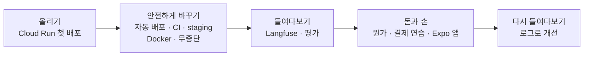
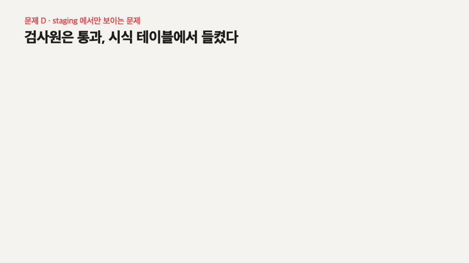
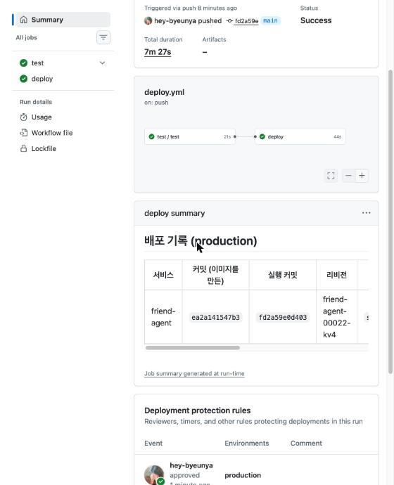
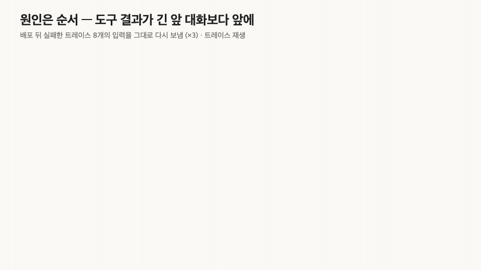
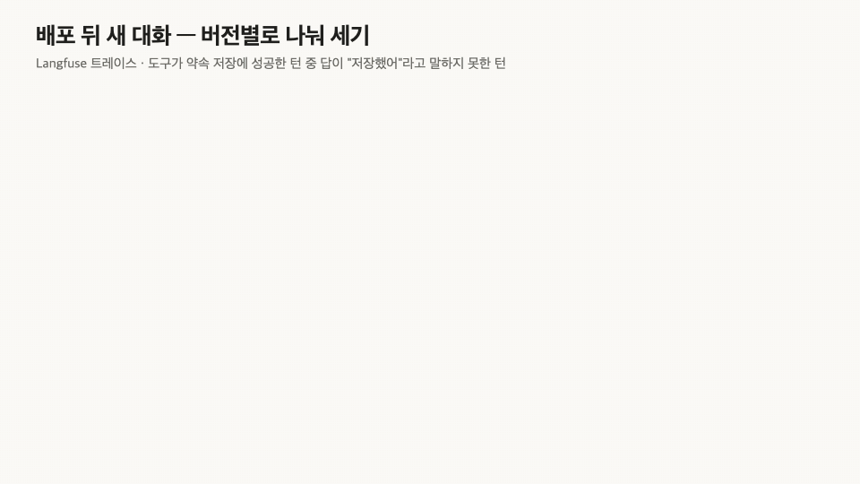
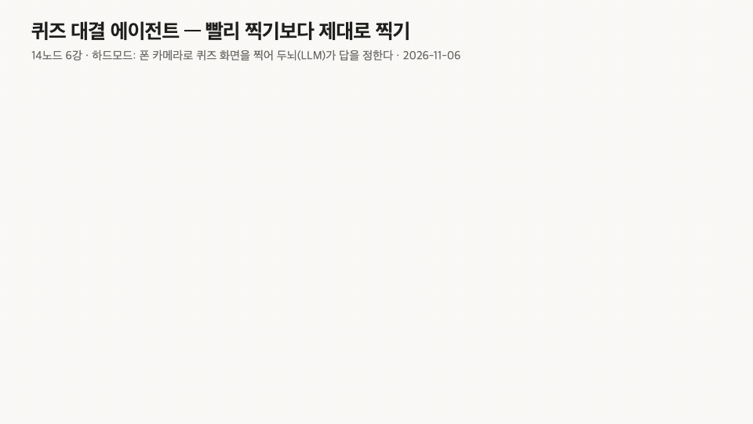
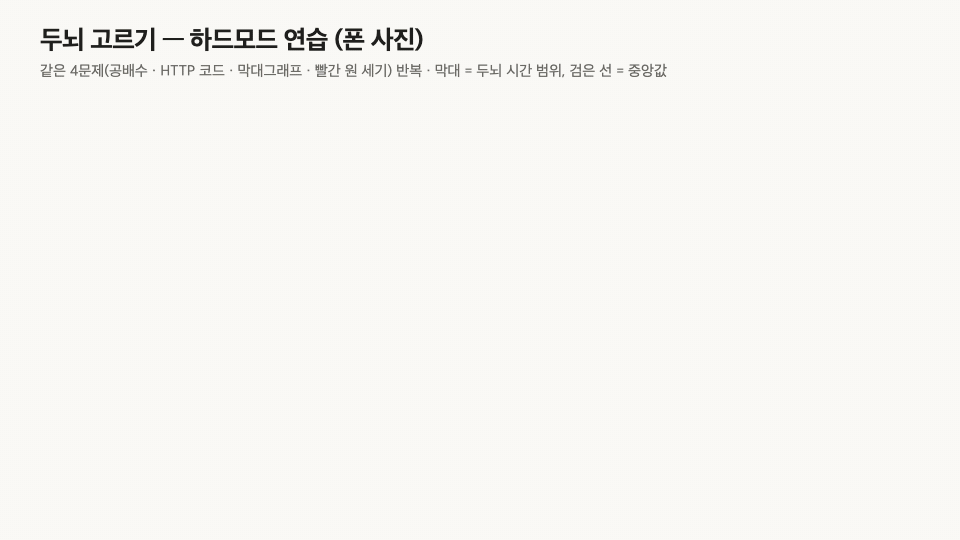

## 들어가며

4주 동안 15개 노드를 들었다. 노트북에서만 돌던 AI 친구 에이전트를 클라우드에 올리고, 머지만 하면 배포되게 하고, 안을 들여다보고, 돈은 어떻게 받아야 하는지 테스트 결제로 연습하고, 폰 앱까지 만들었다.

솔직히 말하면 명령어는 거의 Claude가 쳤다. 나는 "승인"을 누르고, 중간중간 **"그게 무슨 뜻이야?"** 를 물었다. 그래서 이 회고는 내가 한 일보다 **내가 속은 장면과 헷갈렸던 질문** 위주다. Claude가 강의 내내 식당에 빗대 설명해 줬는데 그게 제일 오래 남아서, 용어 옆 괄호에 같이 적는다.

---

## 1. 초록불에 네 번 속았다

| 초록불 | 실제로는 | 어떻게 알았나 |
|---|---|---|
| 테스트(맛 검사표) 11개 통과 | 화면에서 **보내기 버튼이 사라짐** | staging(시식 테이블)에서 직접 눌러 봄 |
| 서버(주방) 전환 실패 0건 | 친구가 **방금 한 약속을 잊음** | 대화를 주방 밖 공용 장부(DB)로 옮김 |
| 서버 로그(처리 완료 영수증) `200` | "도쿄 날씨 어때?"에 **엉뚱한 답** | 트레이스(동선 기록지)를 답부터 거꾸로 읽음 |
| 데이터셋(시식 메뉴판) 22/24 통과 | 배포 뒤 새 대화 **8턴 중 5턴 실패** | 실패한 입력을 그대로 다시 보냄 |

_`display:none` 한 단어. 검사원(CI)은 검사표에 적힌 것만 본다._

맛 검사표(테스트)는 화면을 안 보고, 안내 데스크(로드밸런서)는 기억을 안 보고, 처리 완료 도장(상태 코드)은 답의 내용을 안 본다. 다들 **자기 일만 성실하게** 한다. 문제는 내가 그걸 "다 괜찮다"로 읽었다는 거다.

---

## 2. 내가 헷갈렸던 것들

강의 중에 따로 물어본 질문들이다. 그때는 진짜 몰랐다.

| 내가 한 질문 | 결국 이해한 말 | 나중에 본 장면 |
|---|---|---|
| "트래픽 100%를 받는다는 게 이해가 안 돼" | 손님을 어느 주방(리비전)으로 보낼지 정하는 **비율**. 옛 주방은 문을 연 채 손님만 0 | 되돌릴 때 옛 주방이 그대로 있었다 |
| "무상태의 개념 이해가 안 돼" | 처음엔 "상태가 **없음**"인 줄, 다음엔 "상태를 **관리 안 함**"인 줄 알았다. 실은 상태는 있는데 **주방(서버)이 안 들고 있음**. 기억은 주방 밖 공용 장부(DB)에 | 주방 안 메모지(메모리)에 둔 약속은 주방을 바꾸자 사라졌다 |
| "flush가 하는 역할 더 쉽게 설명해줘" | 기록원(Langfuse)이 모아 둔 동선 기록지 묶음을 **지금 당장** 갖다 놓으라는 것 | 근데 staging 기록 누락의 원인은 flush가 아니었다 |
| (훈련) "production은 어느 커밋인가?" | 밀봉 도시락(이미지)의 **지문(다이제스트)** 과 레시피 판 번호(커밋)를 이어 봐야 답이 나온다 | 아침엔 Actions 실행 시간을 적어 냈다 |

flush는 좀 억울하다. 설명을 듣고 "아 그래서 기록이 빠졌구나" 했는데, flush를 넣고 배포해도 그대로였다. 진짜 원인은 FastAPI(파이썬으로 API 서버를 만드는 웹 프레임워크, 주문서 양식이 정해진 주방)가 스스로 켜는 추적 기능이었다. **강의 설명을 원인이라고 믿고 헛배포 한 번.**

마지막 줄은 더 민망하다. 아침 훈련에서 "production이 어느 커밋이냐"는 질문에 커밋 대신 실행 시간을 적었다. 저녁에는 배포마다 커밋·리비전·지문을 표로 남기게 바꿨고, 되돌리기도 **3분 29초**에 했다.

{: width="420" }
_사람이 헷갈리니까 워크플로가 대신 적는다._

---

## 3. 데이터셋은 통과했는데

마지막 노드에서 고친 버그는 "방금 저장한 약속을 **이미 있다**고 답하는" 거였다. 지시문(레시피 카드)에 "'이미'를 쓰지 마"를 넣었더니 기준(문제 항목 8개 × 3번 = 24번 중 22번 이상)을 넘겼다. 배포했다. 새 대화에서 친구가 말했다. **"기억하고 있어!"** 단어 하나 막았더니 비슷한 다른 말로 옮겨 갔다.

"실제처럼" 만든 시식 메뉴(데이터셋 항목) 15개는 전부 통과했다. 실패가 재현이 안 됐다. 결국 실패한 대화의 입력을 그대로 다시 보내고서야 보였다.

_"저장했다"는 도구 결과가 앞 대화 20개보다 **앞**에 묻혀 있었다. 순서만 바꾸니 13/24 → 24/24. (실패한 대화 8턴 × 3번 = 24번)_

지난 회고에 "금지는 금지 목록에 적어야 읽힌다"고 썼다. 이번엔 **금지 목록으로도 안 됐다.** 무엇을 말하라고 했느냐보다 **무엇을 어떤 순서로 읽게 했느냐**가 문제였다. 내가 상상해서 만든 데이터로는 끝까지 못 찾았을 거다.

---

## 4. 퀴즈 대결: 제일 빨리 틀린 팀

14노드 "내 앱 만들기" 시간에 반 전체가 퀴즈 대결을 했다. 폰 앱(Expo Go, 공용 분점)이 0.5초마다 문제가 열렸는지 묻고, 하드모드면 프로젝터 화면을 찍어 노트북의 두뇌 서버(본점 주방)로 보낸다. 두뇌(LLM, 셰프)가 사진을 보고 답을 고른다. 점수는 정답 1,000점에 속도 가산이 최대 500점.

**1차 대회 결과: 속도 1등, 정답 0개.** 제일 빨리 틀렸다. 두뇌가 낸 답은 `-1`, 빈 답, `"EXPO"`, `"1"`, `"판독 불가"`. 세 번째 문제에서는 앱이 요청을 끊자 서버까지 같이 꺼졌다.

이번에도 감으로 고치지 않고 받은 사진부터 남겨서 열어 봤다.

- 카운트다운 **"1"** 만 찍혀 있었다. 문제는 열렸는데 화면이 아직 안 바뀐 거다.
- 문제 글은 보이는데 그림이 아직 안 떴다.
- 사람 얼굴, 천장. 카메라가 화면을 안 보고 있었다.

하드모드 문제 정보에는 그림 주소도 없다. **사진이 유일한 단서**인데, 그 사진을 너무 빨리 찍고 있었다. 빠르다는 초록불 뒤에 아무것도 없었다.

| 바꾼 것 | 전 → 후 |
|---|---|
| 첫 사진 대기 | 0초 → **0.45초** (0.3초는 카운트다운이 찍힘) |
| 다시 찍기 | 없음 → 두뇌가 "안 보임"이라고 하면 0.4초 뒤 다시 |
| 마감 시각 | 서버가 준 **초** 단위를 앱이 **밀리초**로 읽어 "이미 마감"으로 본 것으로 보임 → 서버 시각 기준으로 |
| 두뇌(셰프) | Opus 5.5 low → **Sonnet 5.5 high** |

_1초 빠른 것보다 한 문제 덜 틀리는 게 점수가 크다. 그래서 틀린 적 없고 덜 느린 쪽을 골랐다._

해 보고 버린 것도 있다. 사진 3장 한꺼번에 보내기, 답 전에 풀이부터 쓰게 하기(평균 3.3초 느려짐), 문제를 일부러 늦게 받아 시간 줄이기. 마지막 건 규칙의 빈틈이라 안 썼다. 양심은 있다.

결과는 연습 하드모드 **20문제 20정답**. 그래도 순위는 2등이었다. 1등 팀은 3.70초, 우리는 세는 문제 하나에 4초쯤 걸렸다.

오후 5시 재대결에서는 15문제를 모두 첫 사진에서 읽었고 12번까지 2등이었다. 중간에 실수로 **"나가기"** 를 누르는 바람에 다시 들어갔고, 13·14번은 맞혔다. 15번에서 두뇌가 표 계산의 **마지막 덧셈**을 틀렸다(382,000을 352,000으로). 최종 순위는 **순위 밖**. 지난 회고에 "코드가 아는 값은 코드로 계산한다"고 써 놓고 덧셈을 LLM한테 맡긴 거다. 사진은 잘 읽는 셰프한테 계산까지 시킨 내가 문제였다.

반전은 그다음 **이지모드**였다. 하드모드만 붙잡고 연습하느라 이지모드는 한 번도 따로 시험해 보지 않았다. 이지모드는 사진을 찍을 필요 없이 문제 글과 그림을 그대로 받는다. 두뇌는 15문제를 문제마다 1~4초 안에 답했고, 하드모드에서 틀린 그 표 문제도 이번엔 382,000으로 맞혔다. 흐릿한 폰 사진 대신 깨끗한 원본을 받으니 덧셈도 됐다.

결과는 **이지모드 2등**. 기대도 안 한 쪽에서 상이 나왔고, 끝나고 **인터뷰**까지 했다. 죽어라 판 하드모드는 순위 밖, 손도 안 댄 이지모드는 2등. 인터뷰를 마치고 나서야 진짜 하고 싶던 말이 떠올랐다. **"소넷 5.5 high의 저력을 알렸어야했는데!"** 준비한 만큼 나오는 게 아니라, 원본을 제대로 받느냐가 더 컸다.

---

## 5. 실전 프로젝트에 가져가 봤더니

수업에서 배운 걸 강의 실습에만 두지 않고 내 프로젝트 네 개에 바로 옮겼다. 결과는 대체로 "배운 대로 됐다"가 아니라 **"배운 대로 했더니 다른 데서 터졌다"** 였다.

| 프로젝트 | 가져간 것 | 실제로 일어난 일 |
|---|---|---|
| 이미 있어 (물건 관리 앱) | CI(검사원)·테스트(맛 검사표) (5노드) | 스모크·비밀값 검사 → **틀리면 사용자가 바로 다치는 함수 다섯**에 단위 테스트 → 매일 밤 보안 점검. 시간대 사건을 보고 앱의 "오늘" 날짜도 한국 시간으로 고정 |
| 이미 있어 AI | 시식한 도시락(이미지)만 홀로 내보내기 (7노드), 원가 상한 (12노드) | 무료 비공개 저장소라 브랜치 보호가 안 됐다. 머지하면서 **staging 브랜치가 자동으로 지워졌고**, 시식 테이블(staging)과 내용물을 비교하는 검사가 실패해 production 배포가 멈췄다. 검사가 일했다 |
| 망상설정집 (창작 도구) | CI·staging, Langfuse(기록원) 반응 수집 (5·10노드) | Langfuse 기록이 **무료 한도(월 5만)** 근처까지 찼다. 범인은 나. 로컬 테스트가 운영 키로 한 번에 **758번** 기록을 보내고 있었다. 기록원을 들였더니 기록원이 제일 시끄러웠다 |
| 뇌 CPR 일지 (기억으로 영화·책 찾기) | 기준은 미리, 모자라도 안 낮춤 (11노드) | 새 규칙을 유료로 재 보고 미리 정한 기준(2/3)에 못 미치면(10/24) 그냥 버렸다. 그러다 **AI가 1위를 올려 주면 "확신 낮음"이 "높음"으로 덮이는** 걸 찾았다. 정답 없는 문장 24개 중 확신 낮음이 14개에서 4개로 |

마지막 줄이 이번 모듈 주제 그대로다. AI가 "이거 같아요"라고 말하면 시스템이 자신감을 얻는다. **초록불이 하나 더 켜졌을 뿐인데 다들 안심한다.** 결국 이건 고치지 못했고, "비슷한 작품일 수 있어요"라는 안내 문구를 붙이는 걸로 타협했다.

---

## 마치며

1. 초록불은 자기가 맡은 것만 말해 준다. 뭘 **안** 보는지부터 적자.
2. "고쳤다"는 숫자로 말한다. 기준은 실험 **전에** 적고, 모자라도 안 낮춘다.
3. 실패한 원본(트레이스·사진·입력)은 **처음부터** 남긴다. 나중에 남기려고 하면 이미 늦었다.
4. 모르면 그냥 묻는다. 무상태도 flush도 물어보고 나서야 실험 결과가 읽혔다.
